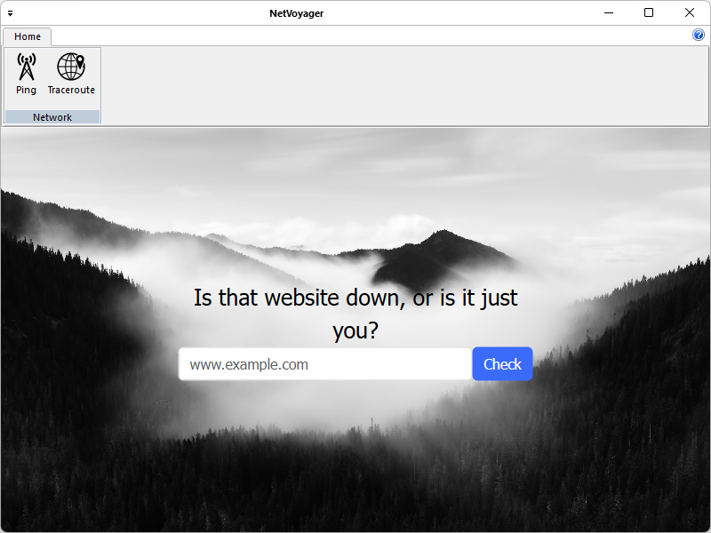
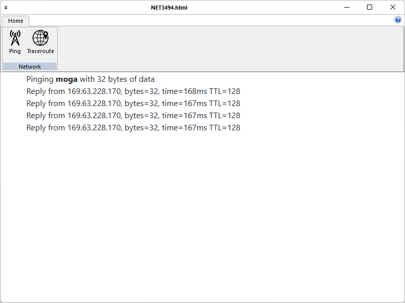
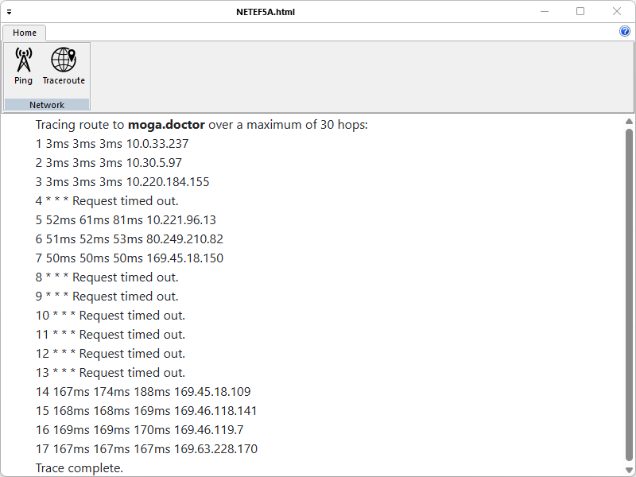

# NetVoyager
NetVoyager is a lightweight network diagnostics app that lets users quickly assess connectivity and trace routes. With built-in ping and traceroute tools, it helps identify latency issues, unreachable hosts, and visualize packet paths. Ideal for IT pros, engineers, and curious users, with a clean UI and real-time results.

## ✨ Features
- **Ping and traceroute** over IPv4 or IPv6.
- **Live diagnostic results**, including latency, packet-loss summaries, and per-hop route details.
- **Optional reverse DNS lookups** to display hostnames for responding IP addresses.
- **Windows desktop interface** built with MFC and WebView2.

## 📦 Installation
Download and run the [NetVoyager installer](https://www.moga.doctor/freeware/NetVoyagerSetup.msi). NetVoyager uses the Microsoft Edge WebView2 Runtime; if it is not already installed, get it from the [WebView2 download page](https://developer.microsoft.com/microsoft-edge/webview2/).

## 🛠️ Build (MSBuild / Visual Studio)

### Requirements
- **Windows 10 or later**
- **Visual Studio 2026** with the **Desktop development with C++** workload and MFC components
- **MSVC v145** and the **Windows 10 SDK**
- **NuGet** for restoring the native dependencies

### Steps
1. Clone the repository:
   ```bash
   git clone https://github.com/mihaimoga/NetVoyager.git
   cd NetVoyager
   ```
2. Restore NuGet packages with `nuget restore NetVoyager.sln`.
3. Open `NetVoyager.sln` in Visual Studio and select **Release | x64** (the solution also includes Win32 configurations).
4. Build with **Build → Build Solution** (`Ctrl+Shift+B`).
-   Output binary: ```.\x64\Release\NetVoyager.exe```

## 🖥️ Using NetVoyager

1. Launch NetVoyager and choose **Ping** or **Traceroute** from the **Home** tab.
2. Enter a hostname or IP address in the prompt.
3. Choose whether to resolve responding IP addresses to hostnames and whether to use IPv6.
4. Review the live ping statistics or traceroute hop results in the main window.





## 🤝 Contributing

1. Fork the repo
2. Create a branch: ```git checkout -b feature/new-probe```
3. Commit: ```git commit -m "Add new probe"```
4. Push: ```git push origin feature/new-probe```
5. Open a PR

## 🗃️ License
This project is licensed under the GNU General Public License v3.0 - see the LICENSE file for details.

## 🙋 FAQ

**Q: Does NetVoyager support IPv6?**
A: Yes. Select the IPv6 option when starting Ping or Traceroute.

**Q: Which platforms are supported?**
A: Windows 10 or later. The solution provides both x64 and Win32 build configurations.

**Q: Does NetVoyager need WebView2?**
A: Yes. The Microsoft Edge WebView2 Runtime is required to display the application interface; install it from the [WebView2 download page](https://developer.microsoft.com/microsoft-edge/webview2/) if needed.

## 🛣️ Roadmap (ideas)

These are ideas, not commitments, and none of them has a date. To work on one, open or comment on an issue first: as described in [CONTRIBUTING.md](CONTRIBUTING.md), a pull request for an enhancement must be attached to an issue that a maintainer has approved with the `Accepted` label, and each pull request should deliver a single feature.

### 1. Export results to JSON or CSV
**Why.** A run currently exists only as formatted text in the results page, so there is no structured copy to save, compare over time, attach to a ticket or open in a spreadsheet.

**What is exported**
- **Ping:** one record per echo request with the sequence number, UTC timestamp (ISO 8601), target as typed, replying address, host name (only when reverse DNS is enabled), payload size, round-trip time in ms, reply TTL where Windows reports one (IPv4 only) and the status code with its text.
- **Traceroute:** one record per hop with the hop number, address, host name, minimum/average/maximum round-trip time and a status (reply, timed out or error).
- **Run details:** NetVoyager version, start and end time (UTC), probe type, target, IP family and the settings in effect (timeout, packet size, TTL or hop limit, number of requests, hops and probes per hop).
- **Summary:** sent, received, lost, loss % and minimum/average/maximum round-trip time, computed from the samples so that an export is self-contained.

**Format rules**
- **JSON:** UTF-8, a top-level `schemaVersion`, a `run` object and an array of records. Numbers are real numbers and missing values are `null`.
- **CSV:** RFC 4180, UTF-8 with a byte order mark so that Excel detects the encoding, one header row, and `.` as the decimal separator whatever the Windows regional settings are.
- **Timeouts are never `0`:** a request that timed out has an empty (CSV) or `null` (JSON) round-trip time, while a sub-millisecond reply (shown as `<1ms`) is exported as `0`.

**Approach**
- Give `CNetVoyagerDoc` (currently empty) a small results model. Worker threads fill it and notify the UI thread with a posted message (see `Messages.h`); they never touch the UI.
- Build the HTML results page and both exports from that one model, so an export always matches what was on screen.
- Add an **Export** group to the **Home** tab with **Export CSV…** and **Export JSON…**, using `CFileDialog` and a default file name made from the target and the time. Enable the commands only when a finished run exists and no probe is running, as `OnUpdatePing` does for **Ping**. Update `Resource.h`, `NetVoyager.rc` and `res\ribbon.mfcribbon-ms` together.
- Escape text that comes from the network (host names) or from the system (error messages) for the target format, and neutralize CSV text cells that start with `=`, `+`, `-`, `@`, a tab or a carriage return to prevent spreadsheet formula injection.

**Out of scope for a first version:** command-line or scheduled export, XLSX/XML, and exporting while a run is still in progress.

**Done when:** the files open cleanly in a spreadsheet and in a JSON parser, the values match the screen for IPv4 and IPv6 runs of both probes, and timeouts are never shown as `0`.

### 2. Dark theme and accessibility improvements
**Why.** The window and the results page stay light whatever the Windows app mode is, and some parts of the interface (the About dialog links, for example) cannot be reached from the keyboard.

**Dark theme**
- **Setting:** *System* (default), *Light* or *Dark*, kept with the other per-user settings and applied without restarting.
- **Follow Windows:** read the Windows app mode at startup and react when it changes while the app is running (`WM_SETTINGCHANGE`).
- **Results page:** set `data-bs-theme` on the generated page (supported by Bootstrap 5.3) and the WebView2 preferred color scheme so that `prefers-color-scheme` agrees with the app. Also set the WebView2 default background color to avoid a white flash while a page loads.
- **Window chrome:** the ribbon, status bar and frame use the light Windows visual manager today. Evaluate a dark-capable visual manager plus the dark title bar attribute (`DWMWA_USE_IMMERSIVE_DARK_MODE`), and step aside when a Windows high-contrast theme is active. Standard dialogs can stay light in a first version.
- **Open questions:** the start page is a remote page (`https://www.ip-address.ro/status.html`) that the app cannot theme, so decide whether to replace it with a local themed page. The results page also loads Bootstrap from a CDN and is unstyled when offline; consider a small bundled stylesheet.

**Accessibility**
- **Keyboard:** add accelerators and KeyTips for **Ping** and **Traceroute** (neither has one today, and `Ctrl+P` is already Print); make the About dialog links reachable with `Tab` and activated with `Enter` or `Space`; add `&` access keys to the label and check boxes of the hostname prompt.
- **Results as a table:** write ping samples and traceroute hops as an HTML `<table>` with a `<caption>` and header cells (`<th scope>`). Today each result is a text line with tab separators, which HTML collapses, so traceroute columns do not line up and a screen reader gets no row or column context.
- **Announcements:** make the start, completion and failure of a run available to screen readers (page title or heading, live region), and give the *Please wait* dialog a text label; it only shows a marquee progress bar today.
- **Contrast and scaling:** at least 4.5:1 text contrast (WCAG 1.4.3) in both themes; respect Windows high-contrast themes and forced colors instead of overriding them; evaluate per-monitor DPI awareness (the application is system-DPI aware today) and check the page at 200 % zoom.
- **Testing:** try it with Narrator and NVDA, and run Accessibility Insights for Windows.

**Done when:** every command is reachable from the keyboard, results are exposed as a table, automated accessibility checks report no failures, the app is readable in both themes and under a high-contrast theme, and the theme follows Windows at startup and when it changes.

### 3. Continuous Integration (GitHub Actions)
**Why.** The repository has no CI (`.github` only contains `FUNDING.yml`). The project has four configurations (Debug and Release for x64 and Win32), needs a specific toolchain (Visual Studio 2026, MSVC v145, statically linked MFC) and runs code analysis on every build, so a change that breaks one configuration is easy to miss.

**Plan**
- Add a workflow under `.github/workflows/` that runs on pushes, pull requests and manual dispatch.
- Use a hosted Windows runner image that includes Visual Studio 2026 (for example `windows-2025-vs2026`) and name it explicitly rather than relying on `windows-latest`, so that a change to the alias cannot silently change the toolchain. Confirm the image provides the MSVC v145 toolset and the MFC/ATL components, and install any missing component in the workflow.
- Restore the two NuGet packages listed in `packages.config` (`Microsoft.Web.WebView2` and `Microsoft.Windows.ImplementationLibrary`), caching them with a key based on `packages.config`.
- Build `NetVoyager.vcxproj` with MSBuild for `Debug|x64`, `Release|x64`, `Debug|Win32` and `Release|Win32`. Build the project rather than the solution because MSBuild cannot build the installer project (`Setup\Setup.vdproj`); the MSI stays a manual step until the installer moves to something MSBuild can build, such as WiX.
- Upload the Release `NetVoyager.exe` and `WebView2Loader.dll` as workflow artifacts.
- Keep the workflow safe and current: `permissions: contents: read`, pinned actions, and Dependabot for the `github-actions` ecosystem. Check whether Dependabot can read this native `packages.config` project; if it cannot, add a scheduled job that reports new WebView2 and WIL versions (WebView2 updates are a recurring item in `ReleaseNotes.html`).
- Begin by failing only on build errors, then tighten for new code-analysis warnings. Once the check is stable, require it with branch protection.

**Later:** CodeQL for C++, a tag-triggered release workflow that also produces the portable zip, a build status badge in this README and a note about the check in `CONTRIBUTING.md`.

**Done when:** a pull request that breaks any of the four configurations shows a failing check, and a successful run on the default branch produces downloadable Release artifacts.

### How the ideas fit together
- **CI** is independent of the others and guards every change that follows, so it is a good first step.
- **Export** introduces the structured results model; the accessible results table can reuse it.
- **Dark theme** is independent of both and can proceed in parallel.
